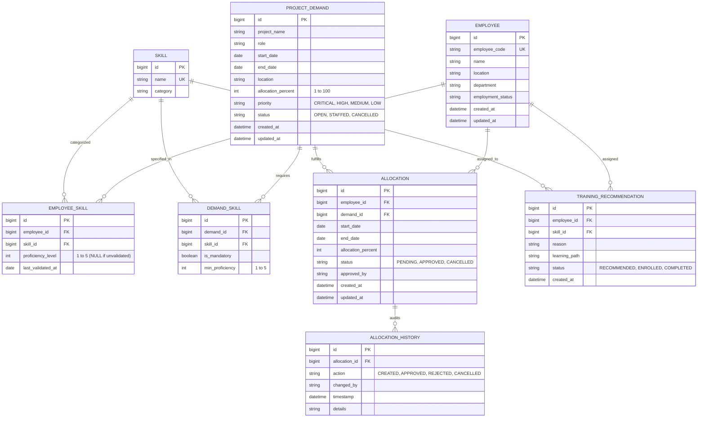

# Architecture & Design Specification: AI-Driven Talent and Resource Allocation Marketplace

## 1. System Overview & Layered Architecture

The **Talent and Resource Allocation Marketplace** is built as a modular, high-integrity Spring Boot application enforcing strict domain-driven business rules, database-backed deterministic candidate scoring, pessimistic concurrency control, and a goal-driven agentic staffing workflow.

```
+-------------------------------------------------------------------------------+
|                       Browser Client (Vanilla HTML5 / CSS3 / JS)              |
|  [Screen 1: Demand Intake]   [Screen 2: Skills Matrix]   [Screen 3: Search]  |
|  [Screen 4: Candidate Comp]  [Screen 5: Approval Flow]   [Screen 6: Dashboard]|
|                      [Screen 7: AI Staffing Assistant]                        |
+-------------------------------------------------------------------------------+
                                      | HTTP REST / JSON
                                      v
+-------------------------------------------------------------------------------+
|                   Spring Security & Controller Layer                          |
|  - Role-based Access Control: ROLE_MANAGER, ROLE_RECRUITER, ROLE_ADMIN        |
|  - Global Exception Handler: Standardized ApiErrorResponse                    |
|  - Controllers: Employee, Skill, Demand, Resource, Allocation, Report, AI     |
+-------------------------------------------------------------------------------+
                                      |
                                      v
+-------------------------------------------------------------------------------+
|                   Application & Domain Service Layer                          |
|  - EmployeeService / SkillService / DemandService                             |
|  - StaffingEngineService (Eligibility, Scoring 0-100, Inclusive Availability) |
|  - AllocationService (Transactional, Pessimistic Locking on Employee Row)     |
|  - ReportingService (Daily Discretized Concurrent Capacity & Talent Deficits) |
|  - StaffingToolsService (6 Controlled Backend Tools)                          |
|  - SimulatedStaffingAgent (Replaceable Goal-Driven LLM/Simulated Adapter)     |
+-------------------------------------------------------------------------------+
                                      |
                                      v
+-------------------------------------------------------------------------------+
|                      Spring Data JPA Repository Layer                         |
|  - Pessimistic Write Locking (@Lock(LockModeType.PESSIMISTIC_WRITE))           |
|  - Overlapping Inclusive-Date Interval Queries                                |
+-------------------------------------------------------------------------------+
                                      | JDBC / SQL
                                      v
+-------------------------------------------------------------------------------+
|                       Relational Persistence Layer                            |
|       MySQL 8.0 (Production / Docker)  /  H2 In-Memory (MySQL Mode)          |
+-------------------------------------------------------------------------------+
```

---

## 2. Entity Relationship Model



---

## 3. Concurrency Control & Transaction Boundaries

1. **Commit-Time Revalidation**:
   When a manager approves an allocation (`POST /api/allocations/{id}/approve`), the backend does not rely on cached scores or client-supplied flags.
2. **Pessimistic Row Locking**:
   The `Employee` row is locked using `SELECT e FROM Employee e WHERE e.id = :id FOR UPDATE` (`LockModeType.PESSIMISTIC_WRITE`).
3. **Capacity Re-evaluation**:
   Within the active lock, the engine queries all currently `APPROVED` allocations overlapping `[startDate, endDate]` using inclusive-date semantics:
   `allocation.startDate <= targetEnd AND allocation.endDate >= targetStart`.
4. **State Transitions**:
   If remaining capacity is strictly $\ge$ requested percentage, the allocation transitions to `APPROVED`, an immutable audit entry is written to `allocation_history`, and the lock is released on commit.
5. **Race Condition Prevention**:
   If two concurrent requests attempt to allocate the same employee beyond 100%, the second transaction waits for the lock, re-reads committed allocations, and is rejected with `409 Conflict (CapacityExceededException)`.

---

## 4. Scoring Algorithm & Weights (0 to 100)

The scoring engine is completely deterministic and grounded in database facts:

$$\text{Total Score} = \text{Skill Match (40)} + \text{Proficiency Fit (30)} + \text{Capacity Score (20)} + \text{Location Fit (10)}$$

- **Skill Match (40 pts)**: Proportion of mandatory and optional skills met.
- **Proficiency Fit (30 pts)**: Baseline points for meeting minimum proficiency plus bonus points for exceeding required proficiency levels (up to 2 levels above threshold).
- **Capacity Score (20 pts)**: Available uncommitted capacity percentage over requested period divided by 100 multiplied by 20.
- **Location Fit (10 pts)**: Exact city match = 10 pts; Remote compatibility = 6 pts; Mismatch = 0 pts.

**Eligibility Separation**: An ineligible candidate (e.g. missing mandatory skill, unvalidated proficiency, or on-leave status) is marked `eligible = false` with explicit exclusion reasons, preventing high scores from bypassing policy gates.

---

## 5. Agentic AI Staffing Workflow & Tool Integration

The agent acts as an autonomous goal-driven staffing orchestrator:
1. `getDemand(id)`: Reads demand parameters.
2. `getCandidateRecommendations(id)`: Invokes deterministic ranking engine.
3. `getEmployeeSkillEvidence(empId)`: Inspects formal assessment dates.
4. `checkAvailability(empId, start, end, cap)`: Runs day-by-day capacity audit.
5. `generateTrainingRecommendations(empId, demandId)`: Synthesizes upskilling pathways for deficit candidates.
6. `submitAllocationRequest(request)`: Submits proposal into `PENDING` state for human manager approval.
